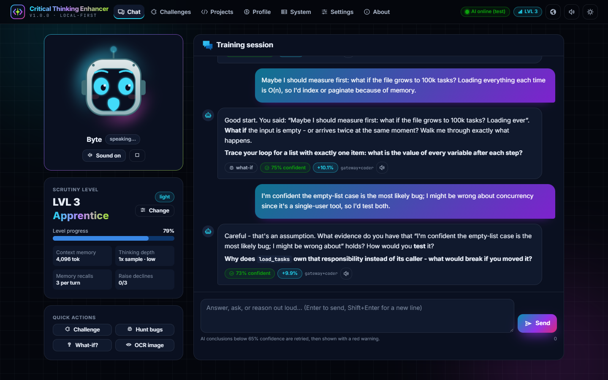
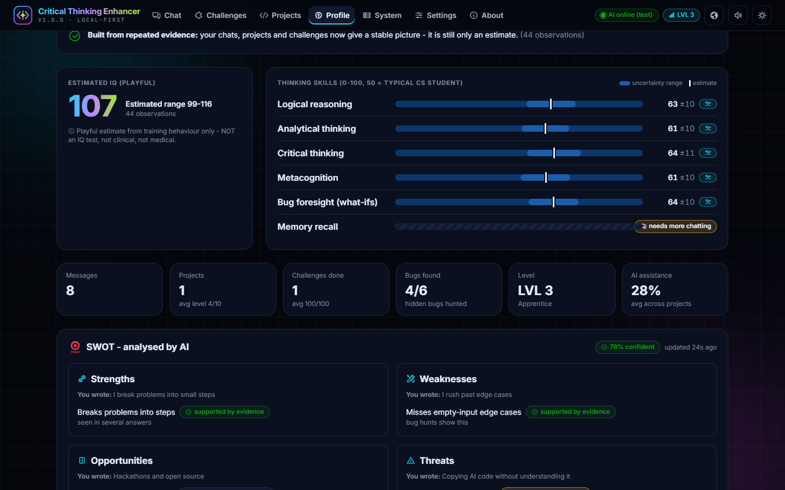
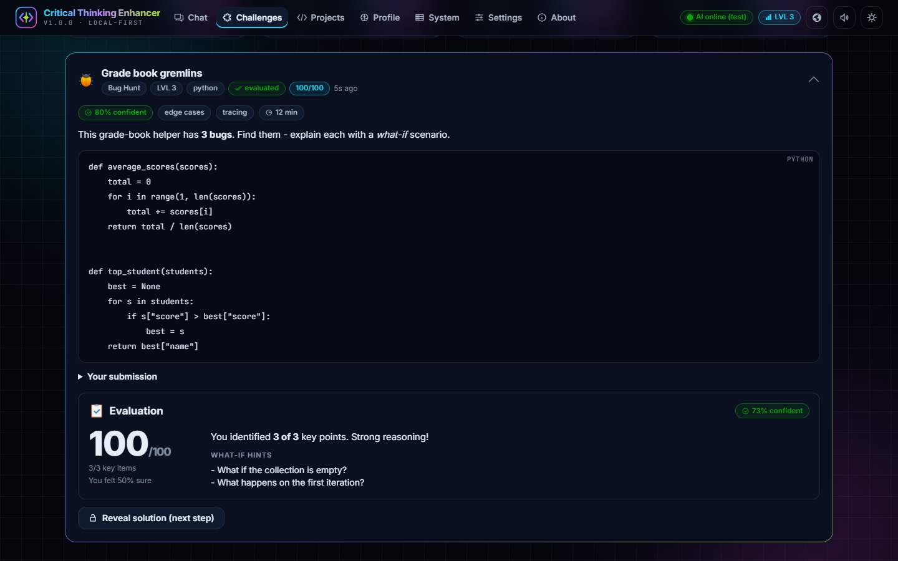
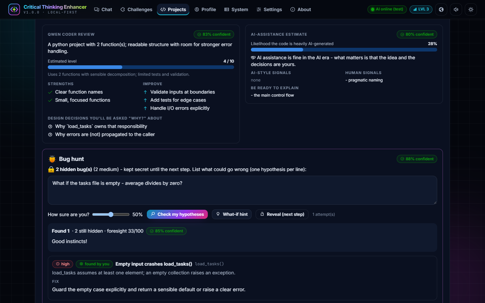
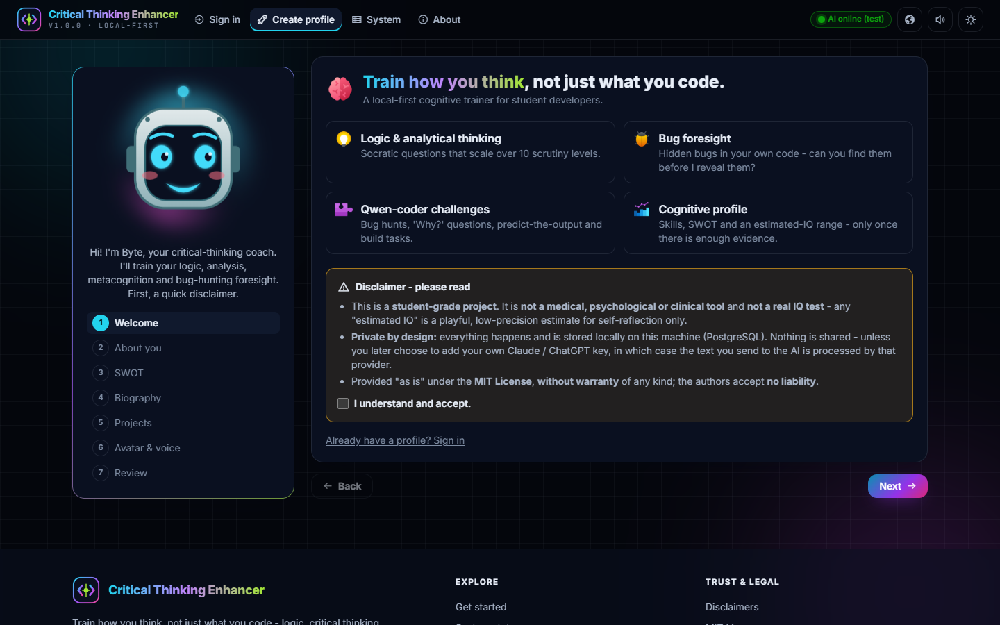
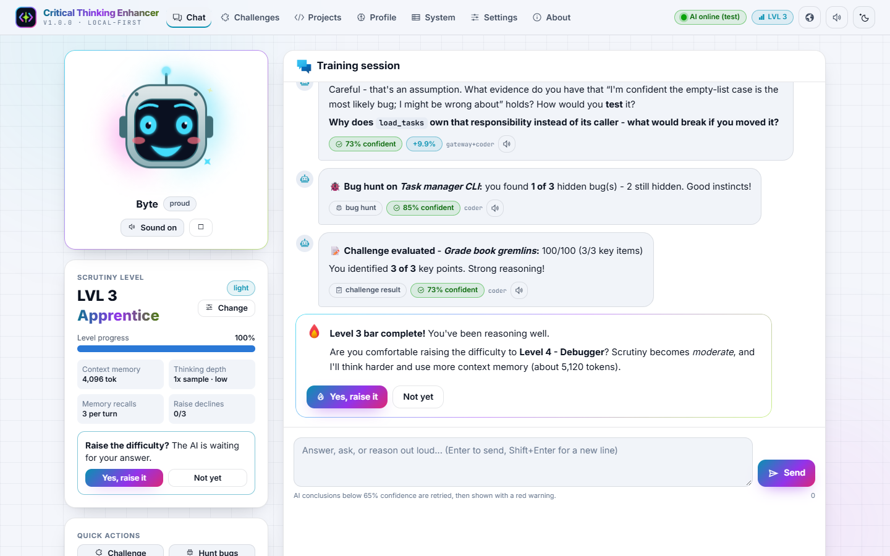
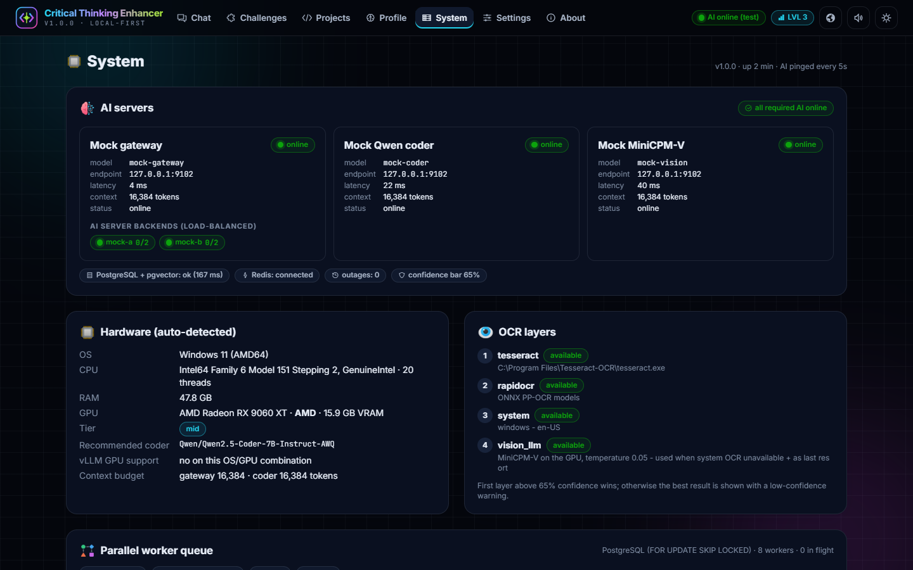
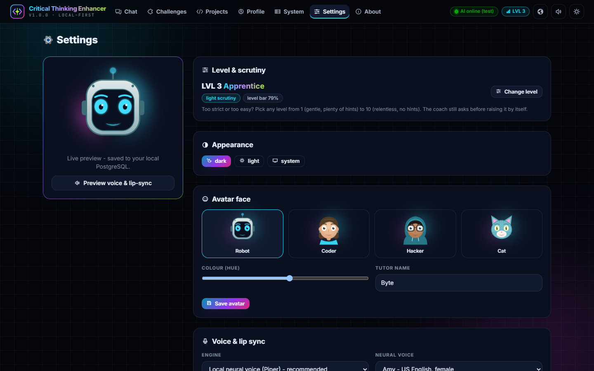
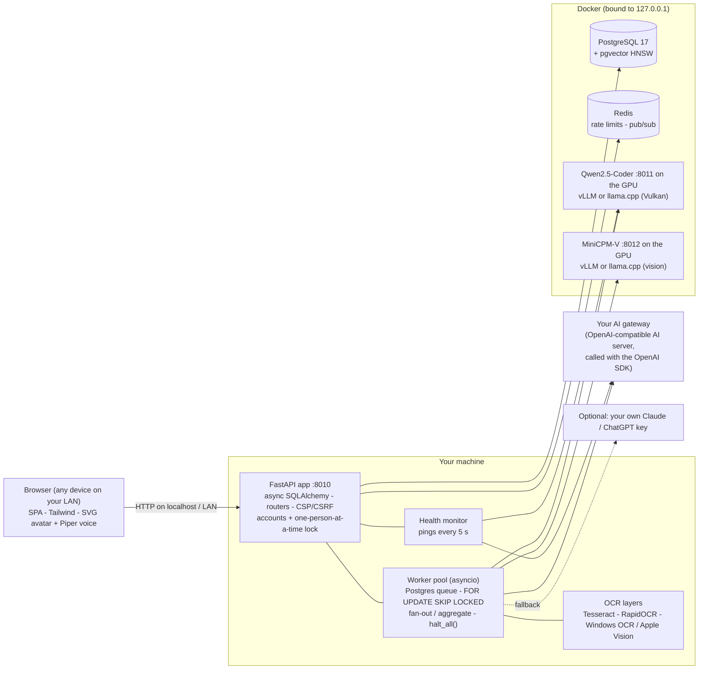

<div align="center">


# Critical Thinking Enhancer

**A local-first cognitive trainer for student developers.**
It sharpens logic, analytical and critical thinking, metacognition and **bug foresight** ("what if...?")
through a talking Socratic AI coach, Qwen-coder challenges and hidden-bug hunts in *your own* code.


-06B6D4?logo=tailwindcss&logoColor=white)


By **Dhurjati Sharma** · [Website](https://my-website-three-mu-29.vercel.app/) · [AI server repo](https://github.com/DHURJATI-JS/ai-server-v2)

</div>

> [!WARNING]
> **Student-grade project - not a medical, psychological or clinical tool, and not an IQ test.**
> The "estimated IQ" is a playful, wide-range estimate from training behaviour, for self-reflection only.
> Provided **as is, without warranty of any kind, and without liability** under the [MIT License](LICENSE).

> [!NOTE]
> **Private by design.** Everything happens and is stored locally on the machine that runs the app (PostgreSQL in Docker).
> No analytics, no tracking, no CDNs at runtime - CSS, icons and fonts are downloaded once by the installer and served locally.
> Only if a user opts in to their *own* Claude / ChatGPT key is the text they send processed by that provider.

---

## Screenshots

| Chat with the talking avatar | Cognitive profile |
|---|---|
|  |  |
| **Qwen-coder challenges** | **Projects: parallel analysis + secret bug hunt** |
|  |  |
| **Onboarding with disclaimer** | **Light mode + "raise the difficulty?" offer** |
|  |  |
| **System status (AI, GPU, OCR, queue)** | **Settings (scrutiny level, theme, face, voice)** |
|  |  |

<sub>Screenshots were taken with the bundled mock AI test server, so the coach's answers are canned.</sub>

## Features

**Coaching**
- **Socratic chatbot with a talking avatar.** Four faces (robot, coder, hacker, cat) with a colour slider, random eye blinking, eyes that follow your cursor and six facial expressions. It speaks with a local **neural voice** (Piper TTS, seven voices) and its **lips move with the actual audio** (Web Audio analyser + mouth shapes from the text). Your browser's voice is a fallback. A **mute button** in the header and the chat silences the voice *and* stops the lip sync. Face, colour, tutor name and voice are stored in PostgreSQL.
- **Every coding question comes from the Qwen coder.** In each chat turn the gateway model coaches the human side, while the local Qwen coder **verifies any code or code claim you write** (bugs, edge cases, wrong complexity) and asks the one critical coding question: a what-if, a why, a prove-it or a trace.
- **Onboarding** asks for name, age, gender, SWOT, a biography and optional projects, plus a starting level. The AI keeps all of it as a reference in a `MutableDict` (JSONB) profile.
- **Ten scrutiny levels.** From *Warm-up* (gentle, generous hints) to *Grandmaster* (relentless, no hints). Higher levels **think harder**: more chat history, more long-term memories pulled in through pgvector, parallel self-consistency samples, higher reasoning effort and a bigger context budget.
- **Level bar and consent.** The bar fills as the session progresses. At 100 % the AI **asks** whether you are comfortable raising the difficulty. Decline three times and it stops, saying the level is cleared and an upgrade is required. Completing level 10 earns a congratulation and confetti.
- **Choose your own scrutiny.** *Settings → Level & scrutiny*, or **Change** on the chat's level card, opens a 1-10 picker. It previews what each level means: how strict the coach is, hints, context memory and thinking depth. Lower it when it's too much, raise it for a real challenge. The bar restarts at the new level, and an earned Level 10 completion stays earned.
- **Memory callbacks.** The coach opens by asking about your projects, and now and then goes back in time to ask whether you remember something from an earlier session (scored as *recall*).

**Code and bug foresight**
- **Projects.** Upload files, a `.zip` or screenshots. Four AI jobs analyse them **in parallel**: Qwen code review with a level estimate, a secret bug hunt, AI-assistance detection and a read on your thinking skills. An aggregator then posts the report into chat.
- **Secret bugs.** Bugs the AI finds stay hidden until the next step. You write your what-if hypotheses with a self-confidence slider, the AI checks them without revealing the ones you missed, and then you can reveal them all.
- **AI-generated-code detection, without judgement.** Transparent heuristics plus the Qwen coder estimate how much of the code an AI wrote. Using AI is fine; the app then checks that *the idea is yours* by asking you why.
- **Qwen-coder challenges.**
  - *Bug Hunt*: find planted bugs.
  - *Why?*: explain a design decision and its trade-offs.
  - *Predict*: trace tricky code and give the exact output.
  - *Build*: write something; the AI analyses it, then hides the bugs it finds in **your** code for a second hunt.

**Cognitive profile**
- Covers logic, analytical thinking, critical thinking, metacognition (including calibration of your self-rated confidence), bug foresight and memory recall.
- Each skill is a confidence-weighted Bayesian average **shrunk toward neutral**, so a few chats cannot swing it. Every skill reports its evidence, and the page shows "**needs more AI chatting**" until there is enough.
- The estimated-IQ range appears only once there is broad evidence: at least 20 observations, 4 skills and 2 sources.
- The AI-analysed SWOT marks each point as *supported*, *contradicted*, *unverified* or *needs more chatting*.

**Reliability and safety**
- **65 % confidence gate.** Every AI conclusion carries a confidence. Below the bar it is retried with a "second look", more tokens and lower temperature. If it is still below the bar it is shown with a **red warning**.
- **Maximum speed when the PC is free.** Every 5 s the app reads your AI server's backend slots and adapts its parallel gateway requests. It uses **all slots** when nothing else is using the server, and steps back to leave room when other work is running. The System page shows the current mode, and every job shows how long it has been running or how long it took.
- **AI availability checked every 5 s.** The AI gateway and the Qwen coder are *required*. If either goes down, every queued and running task is halted and marked failed, Redis broadcasts the halt to all worker processes, and the browser shows an **"AI server stopped working"** dialog.
- **AI spam protection.**
  - Redis sliding-window rate limits and mutes.
  - Heuristics for gibberish, floods, link spam and adverts. They are script-aware, so Hindi or Chinese text is never flagged.
  - Prompt-injection detection that also protects the secret bugs.
  - An AI classifier for grey-zone messages, run in parallel with the reply.
  - A honeypot field and a minimum fill time on onboarding.
- **Multi-layer OCR:** Tesseract → RapidOCR → Windows OCR / Apple Vision → MiniCPM-V on the GPU (vLLM or llama.cpp, temperature 0.05). Each layer is scored; the first one above 65 % wins.
- **Device-aware context memory.** GPU VRAM decides the Qwen size and context length, and the live context window reported by vLLM / llama.cpp caps it further. On a low-end device a banner on every page says to upgrade or add a Claude or ChatGPT key.
- **GPU only.** The Qwen coder always runs on the GPU in Docker: vLLM on NVIDIA (and AMD on Linux with ROCm), llama.cpp with Vulkan on Direct3D 12 for AMD on Windows. Without a usable GPU the coder is simply not started.
- **Local accounts, one person at a time.** Every profile has a username and password (salted scrypt hash) stored only in the local database, plus a one-time recovery key for a forgotten password. The sign-in screen works like a family computer: one profile goes straight to its password; two or more let you choose or add another account.
  - **Only one person can use the app at a time, on any device.** While someone is active, every other device sees "*name* is using the app right now". Signing in, creating a profile, the recovery key and every API call are refused for anyone else. The same person may continue on another of their own devices.
  - The app frees up when they sign out, close the app (no heartbeat for 90 s) or step away (30 minutes without interaction). A device left open never grabs the app by itself: it asks you to press *Continue*.
  - **Delete account** (*Settings → Delete account*, confirmed with your username and password) permanently removes everything that belongs to the profile:
    - login, password and recovery key;
    - chats and memories;
    - projects and uploaded files;
    - challenges;
    - cognitive profile;
    - saved API keys;
    - running AI work.

    Every device is signed out, and the browser forgets the profile too.
- **LAN-ready and hardened.** The app binds to `0.0.0.0`.
  - **Sessions:** per device (HttpOnly, SameSite cookie, only a hash stored). Passwords have brute-force limits, and changing the recovery key or deleting the profile asks for the current password. Fallback keys are encrypted (Fernet).
  - **CSRF:** every state-changing call needs a signed double-submit **CSRF token** (HMAC of an HttpOnly cookie). It also needs a matching `Origin` and same-origin `Sec-Fetch-Site`.
  - **CSP:** a strict **Content-Security-Policy with a fresh nonce on every request**. Scripts run only with that nonce (`'strict-dynamic'`). No inline handlers, `eval`, plugins, framing or `<base>` hijacking.
  - **Talisman-style headers:** HSTS on HTTPS, `X-Frame-Options`, `nosniff`, `Referrer-Policy`, `Permissions-Policy`, COOP/CORP and more. Flask-Talisman only works with Flask, so the app ships a small ASGI port with the same options.
  - **DNS-rebinding guard:** a Host-header allow-list.
  - **Upload limits:** request-size limits that also stop chunked uploads, plus image checks (format allow-list, 30-megapixel cap) against "decompression bombs".
- **Developer UI.** Dark and light mode, a neon gradient theme, and Tailwind v4, Icons8 and Line Awesome icons, all served locally.

## Architecture



## Quick start (one click)

**Windows 10/11:** double-click **`Start-Windows.cmd`**, or run:

```powershell
powershell -ExecutionPolicy Bypass -File scripts\install.ps1
```

**Linux / macOS:**

```bash
chmod +x scripts/install.sh && ./scripts/install.sh
```

Both installers are idempotent. Run them again at any time to start the app; anything already installed is skipped. They:

1. Install whatever is missing: Docker, uv (Python manager), Tesseract, Git, and on Linux with NVIDIA the NVIDIA Container Toolkit.
2. **Detect your GPU** (NVIDIA / AMD) and VRAM, then pick the coder engine, a Qwen2.5-Coder size and a context length. They also pick the docker compose files for your GPU through `COMPOSE_FILE`.
3. Write a private `.env` with random secrets. If a database volume already exists, its original password is kept.
4. Create a Python 3.12 venv, then download **Tailwind CSS (SHA-256 verified), Icons8 icons, fonts, the embedding model and the avatar's voice** locally and build the CSS.
5. Start PostgreSQL + pgvector, Redis and the Qwen coder container (vLLM, or llama.cpp whose GPU image is built on the first run).
6. Optionally open the firewall for your *private* network, then run the app and print the LAN URLs.

Options: `-Yes -NoRun -SkipModels -Vision -LlamaCpp -NoFirewall` on Windows, or `--yes --no-run --skip-models --vision --no-vision --no-firewall` on Linux/macOS.

Then open **http://localhost:8010**, or `http://<this-pc-ip>:8010` from another device on your network.

<details>
<summary><b>Manual setup</b></summary>

```bash
cp .env.example .env                               # then replace every "change-me" value
docker compose up -d postgres redis
# Qwen coder - pick the line for your GPU (models only run on the GPU):
docker compose -f docker-compose.yml -f docker/compose.nvidia.yml --profile coder up -d          # NVIDIA
docker compose -f docker-compose.yml -f docker/compose.amd.yml --profile coder up -d             # AMD on Linux (ROCm)
docker compose -f docker-compose.yml -f docker/compose.llamacpp-dxg.yml build qwen-coder-llama   # AMD on Windows:
docker compose -f docker-compose.yml -f docker/compose.llamacpp-dxg.yml --profile coder-llamacpp --profile vision-llamacpp up -d
uv venv --python 3.12 .venv && uv pip install -r requirements.txt   # uv picks up ./.venv automatically
.venv/bin/python scripts/fetch_assets.py          # Windows: .venv\Scripts\python.exe
.venv/bin/python -m uvicorn app.main:app --host 0.0.0.0 --port 8010   # runs in the foreground
.venv/bin/python -m app.worker                     # optional, in a second terminal: more parallel workers
```
</details>

## Connect your AI

The app needs **two AI services online**, and halts all AI work while either is down.

| Role | What | Configure in `.env` |
|---|---|---|
| **AI gateway** | Your OpenAI-compatible AI server for coaching, evaluation, SWOT and spam checks, called with the official **OpenAI Python SDK** (retries, timeouts, a concurrency cap). Download it from [ai-server-v2](https://github.com/DHURJATI-JS/ai-server-v2) (`config.json` → `app.ai_server_repo`). **Locally-run Gemma is not supported** (the app blocks it); use the AI server instead. | `CTE_GATEWAY_URL`, `CTE_GATEWAY_API_KEY`, `CTE_GATEWAY_MODEL`, `CTE_GATEWAY_MAX_CONCURRENCY` |
| **Qwen coder** | Runs locally on your GPU in Docker: vLLM, or llama.cpp (Vulkan) for AMD on Windows. It asks every coding question in chat, verifies your code, and handles code review, bug hunts, AI detection and challenges. Parallel requests are served (`CODER_PARALLEL` slots on llama.cpp). | `CTE_CODER_URL`, `CTE_CODER_MODEL`, `QWEN_CODER_MODEL` / `QWEN_CODER_GGUF` |
| Vision (optional) | MiniCPM-V, the last OCR layer, on the GPU: vLLM, or llama.cpp with its vision projector (AMD on Windows, from 12 GB of VRAM). It matters most where no OS-native OCR exists (Linux). | `CTE_VISION_ENABLED`, `CTE_VISION_URL`, `VISION_MODEL` / `VISION_GGUF` |
| Fallback (optional) | A user's own **Claude** or **ChatGPT** key, entered in Settings. Used when local AI is offline or the device is too low-end for a level's context. | stored encrypted per user |

**Automatic model choice for the Qwen coder (by VRAM):**

| VRAM | vLLM (NVIDIA; AMD on Linux) | llama.cpp (AMD on Windows, or `-LlamaCpp`) |
|---|---|---|
| ≥ 40 GB | Qwen2.5-Coder-32B-Instruct-AWQ, 32k | Qwen2.5-Coder-7B GGUF Q4_K_M, 16k |
| ≥ 20 GB | Qwen2.5-Coder-14B-Instruct-AWQ, 32k | Qwen2.5-Coder-7B GGUF Q4_K_M, 16k |
| ≥ 12 GB | Qwen2.5-Coder-7B-Instruct-AWQ, 16k | Qwen2.5-Coder-7B GGUF Q4_K_M, 16k |
| ≥ 8 GB | Qwen2.5-Coder-7B-Instruct-AWQ, 8k | 7B (≥ 10 GB) or 3B GGUF Q4_K_M, 16k |
| ≥ 6 GB | Qwen2.5-Coder-3B-Instruct-AWQ, 8k | Qwen2.5-Coder-3B GGUF Q4_K_M, 16k |
| ≥ 4 GB | - | Qwen2.5-Coder-1.5B GGUF Q4_K_M, 8k |
| less | no local coder (models never run on the CPU): use a GPU machine, your AI server, or a Claude / ChatGPT key | |

llama.cpp splits its context over `CODER_PARALLEL` (default 2) slots so two requests run at once. A model you set yourself in `.env` (`QWEN_CODER_GGUF`) is kept when the installer runs again.

> [!IMPORTANT]
> **AMD GPUs**
> - **Windows** (for example the RX 9060 XT): vLLM's ROCm build is Linux-only and Docker Desktop cannot pass AMD GPUs to it. The installer therefore builds a llama.cpp image with the **Vulkan** backend. It reaches the GPU through Mesa **Dozen** (Vulkan on Direct3D 12) and WSL2 GPU paravirtualisation (`/dev/dxg`), still inside Docker (`docker/compose.llamacpp-dxg.yml`). The first build takes 5-10 minutes.
> - **Linux:** `docker/compose.amd.yml` runs vLLM on ROCm. RDNA4 cards (gfx1200/1201) need a `gfx120X-all` tag of [`rocm/vllm`](https://hub.docker.com/r/rocm/vllm/tags) set in `VLLM_ROCM_IMAGE`.

<details>
<summary><b>Try it without any GPU (test mode)</b></summary>

A mock OpenAI-compatible server returns schema-correct answers for every task. The UI shows a **Test mode** banner while it is in use.

```powershell
docker compose up -d postgres redis
# terminal 1 - the mock AI (keeps running):
.venv\Scripts\python.exe -m tests.mock_ai_server --port 9101
# terminal 2 - the app pointed at it:
$env:CTE_GATEWAY_URL="http://127.0.0.1:9101/v1"; $env:CTE_GATEWAY_MODEL="mock-gateway"
$env:CTE_CODER_URL="http://127.0.0.1:9101/v1";   $env:CTE_CODER_MODEL="mock-coder"
$env:CTE_VISION_URL="http://127.0.0.1:9101/v1";  $env:CTE_VISION_MODEL="mock-vision"
.venv\Scripts\python.exe -m uvicorn app.main:app --host 0.0.0.0 --port 8010
```
</details>

## Configuration

`config.json` is safe to commit. Its secrets are `${ENV_VAR:-default}` placeholders, resolved from the environment or the git-ignored `.env`.

| Key | Default | Meaning |
|---|---|---|
| `app.author` | `Dhurjati Sharma` | Shown in the footer and the About page's license (put your own name here if you fork) |
| `app.vercel_url` | `https://my-website-three-mu-29.vercel.app/` | Author website, linked from the header, footer and About page |
| `app.ai_server_repo` | `https://github.com/DHURJATI-JS/ai-server-v2` | Link shown wherever users are told to download the AI server |
| `app.port` | `8010` | Web port; the app binds to `0.0.0.0` for LAN access |
| `app.single_active_user` | `true` | Only one person can use the app at a time, on any device |
| `app.lock_heartbeat_seconds` | `90` | The app frees up this long after the active person's browser stops checking in (tab closed) |
| `app.lock_idle_minutes` | `30` | ...or after this long without any interaction |
| `app.list_profiles_on_signin` | `true` | Family-style sign-in screen showing each profile's name and avatar (`false`: type your username) |
| `security.allowed_hosts` | `[]` | Extra host names you open the app with (IP addresses, `localhost` and this PC's own names always work). `"*"` turns the DNS-rebinding guard off |
| `security.force_https` | `false` | Redirect to HTTPS - only behind TLS. HSTS is sent automatically on HTTPS responses |
| `security.csp_report_only` | `false` | Log CSP violations in the browser console instead of blocking (debugging) |
| `security.trusted_origins` | `[]` | Extra origins allowed to POST (only behind a reverse proxy that rewrites the Host header) |
| `ai.health_interval_seconds` | `5` | How often the AI servers are pinged |
| `ai.gateway.adaptive_concurrency` | `true` | Use every free AI-server slot when it is idle (`max_concurrency` is the starting value, `concurrency_ceiling` the upper bound) |
| `ai.confidence_threshold` | `0.65` | Minimum confidence before an AI conclusion is accepted without a warning |
| `ai.confidence_max_retries` | `2` | Retries before a result is shown as low confidence |
| `ai.blocked_local_model_keywords` | `["gemma"]` | Locally-run models that are refused |
| `ocr.layers` | Tesseract → RapidOCR → system → vision LLM | OCR order; `use_system_ocr` toggles Windows OCR / Apple Vision |
| `workers.concurrency` | `6` | Parallel AI workers per process |
| `spam.*` | see file | Rate limits, block/AI-check thresholds, mute policy |
| `levels.max_declines_before_lock` | `3` | Declined raises before a level counts as cleared |

## How the important parts work

<details>
<summary><b>Confidence gate</b></summary>

Every prompt requires a JSON `confidence`. The effective confidence is built from:
- the model's own report,
- halved when required fields are missing,
- blended with token probabilities when the server exposes `logprobs`,
- and, at levels 6 and above, scaled by agreement between parallel self-consistency samples.

Results below `0.65` are retried twice ("second look", more tokens, lower temperature). The best attempt is then returned with `low_confidence`, which the UI renders as a red warning.
</details>

<details>
<summary><b>Parallel worker queue and outage halting</b></summary>

Jobs are rows in PostgreSQL. N async workers per process claim them with `FOR UPDATE SKIP LOCKED`; add processes with `python -m app.worker`. Project uploads fan out into four child jobs, and the last one to finish enqueues an aggregator.

The health monitor pings the gateway and coder every 5 s, and a worker that hits a connection failure triggers an immediate re-check. On an outage `halt_all()`:
1. cancels in-flight tasks,
2. marks every queued, running and waiting job `failed` ("AI server stopped working"),
3. releases projects and challenges stuck mid-analysis,
4. and publishes a halt event on Redis so other worker processes stop too.

A janitor sweeps jobs orphaned by crashes and upload leftovers. Each deployment (one PostgreSQL database) has its own upload folder and Redis channels, so the isolated test stack can never halt the real app's jobs or delete its files.
</details>

<details>
<summary><b>One person at a time (single active user)</b></summary>

The lock is one row in PostgreSQL (`app_state.active_user`), taken with `SELECT ... FOR UPDATE`, so two people pressing *Sign in* at the same moment can never both get in.
- Every real API call by the holder refreshes their **activity**.
- The browser's 5-second health ping and automatic polling (marked `X-CTE-Background`) only refresh the **heartbeat**: they keep the holder's lock alive but never take a free lock and never reset the idle timer.
- Anyone else gets `423 APP_IN_USE` from every endpoint, including sign-in, profile creation and the recovery key, and their devices show only the holder's first name.
- Signing out releases the lock at once. Otherwise it expires after `lock_heartbeat_seconds` without a heartbeat or `lock_idle_minutes` without activity.
</details>

<details>
<summary><b>Cognitive profile maths</b></summary>

Each observation (0-100) carries a confidence weight. Chat evidence is capped at 0.6, project evidence at 0.45 and challenge evidence at 0.7.

A skill score is `(50·4 + Σ wᵢ·sᵢ) / (4 + Σ wᵢ)` with a ± margin of `25/√(1+Σw)`. A skill stays "needs more chatting" until its evidence weight reaches 3. The estimated IQ maps the weighted composite to `100 + (composite-50)·0.6`, clamped to 70-145 and shown as a range. It is only shown with broad evidence and always carries the disclaimer.
</details>

<details>
<summary><b>Levels</b></summary>

| Level | Name | Scrutiny | History | pgvector memories | Context requested | Samples |
|---|---|---|---|---|---|---|
| 1 | Warm-up | gentle | 6 | 2 | 2,048 | 1 |
| 3 | Apprentice | light | 10 | 3 | 4,096 | 1 |
| 5 | Analyst | moderate | 14 | 5 | 6,144 | 1 |
| 7 | Skeptic | strict | 22 | 7 | 10,240 | 2 |
| 10 | Grandmaster | relentless | 40 | 12 | 24,576 | 3 |

The context actually used is `min(requested, what this device / model can serve)`. The System page shows the full table for your hardware.
</details>

## Testing: stress test and bug hunt

```bash
python -m pytest -q                                       # 87 unit tests
python scripts/stress_test.py --projects 6 --turns 3      # isolated stack: own DB, Redis db 1, mock AI
python -m tests.ui_smoke http://127.0.0.1:8020            # optional real-browser walkthrough (pip install playwright; uses Edge/Chrome)
```

The stress test runs an **isolated** stack on its own ports and database: database `cte_test`, Redis db 1, its own pub/sub channels and upload folder, the app on :8020 and the mock AI on :9102. It drives the app end to end and then attacks the edges. Three independent read-only reviews were also run as a bug hunt: backend security, the job queue and AI pipeline, and the frontend and installers. All 41 findings were fixed and are covered by the checks below.

Latest result: **125/125 checks passed**, 87/87 unit tests, and the browser walkthrough of every page (light, dark and phone width, including the lock screens and deleting an account) ran with **no JavaScript errors and no CSP violations**.

| Area | Checked |
|---|---|
| Parallel work | One person: 6 project uploads, 3 challenges and a chat turn at once. Up to 10 AI calls in flight; every job succeeded. Never more than 3 challenges generated at once. Double submits are evaluated once. |
| Qwen coder | Every chat turn's coding question comes from Qwen, and code pasted into the chat is verified. |
| One person at a time | A second person is refused everywhere (sign-in, new profile, recovery key, text-to-speech, every API, background polls), while the same person may use a second device. The app frees up on sign-out, a closed tab or the idle timeout; heartbeats and open tabs never grab it; of two simultaneous sign-ins exactly one wins. |
| Data leaks | Bob cannot read, change or delete any of Alice's data by id (404). Blocked devices and public endpoints carry no personal data, and no API returns password hashes, recovery keys or API keys. |
| Accounts | Wrong password and unknown user get the same answer; 10 wrong passwords lock that name (429). A new password signs out other devices. A new recovery key and deleting the profile need the password. |
| CSRF / CSP / headers | Missing, forged, stolen and cross-site tokens are refused (also for login). A fresh CSP nonce on every request matches every `<script>`. Talisman headers present, no HSTS over plain HTTP, `no-store` for API and page. |
| Hardening | DNS-rebinding Host check (400). Chunked uploads without Content-Length are stopped at the limit (413), and oversized uploads get 413 too. A decompression-bomb PNG and PostScript disguised as a PNG are refused before decoding. Zip-slip is rejected. |
| Secrets | Hidden bugs and challenge answers never appear in API responses before the reveal. |
| Spam protection | Gibberish, floods and adverts are blocked and repeat offenders muted. Prompt injection is caught by the parallel AI check, and rate limits are enforced. |
| Confidence gate | Low confidence → 3 attempts → red warning; confident → accepted first time. The IQ estimate is withheld until there is broad evidence. |
| AI outage | Detected in about 2 s; in-flight jobs halted and failed; 503 while offline; recovery in about 4 s. |
| Levels | Offer at 100 % → decline ×3 → locked (409) → upgrade; level 10 → congratulations. |

With the mock AI (300 ms latency) the parallel batch of 10 jobs takes about 1 s and a chat turn about 0.6 s. With real models, inference time dominates.

## Project structure

```
app/
  main.py            FastAPI app, lifespan, CSP/CSRF middleware        worker.py  extra worker processes
  config.py          config.json + .env interpolation, Gemma guard      bus.py     Redis rate limits + pub/sub
  models.py db.py    SQLAlchemy 2 async models (MutableDict JSONB, pgvector)
  ai/                providers (OpenAI-compatible, Anthropic), router + fallback, 5 s health monitor,
                     confidence gate, prompts, embeddings (fastembed -> hashing)
  workers/           Postgres job queue, chat / project / challenge handlers
  services/          levels, progression, profile maths, memory (pgvector), ingestion, AI-code heuristics,
                     hardware, Piper TTS, single-active-user lock
  security/          accounts + sessions, scrypt passwords, AI spam protection, encryption
  ocr/               Tesseract -> RapidOCR -> Windows OCR / Apple Vision -> MiniCPM-V
  routers/           REST API          static/   SPA (Tailwind, SVG avatar, neural voice + lip sync)
docker-compose.yml   postgres+pgvector, redis, Qwen coder (vLLM or llama.cpp), minicpm-v
docker/              GPU overrides: NVIDIA, AMD/ROCm, llama.cpp Vulkan-on-D3D12 image
scripts/             install.ps1, install.sh, fetch_assets.py, stress_test.py
tests/               unit tests, mock AI server, UI smoke test
```

## Troubleshooting

- **"AI server stopped working" dialog.** The gateway or the Qwen coder is not answering. Open **System** to see which one and why, start it, or add a fallback key in Settings. The dialog closes by itself when they come back.
- **Other devices can't connect.** Allow TCP 8010 on your *private* network firewall. The installer offers to do this.
- **Database password errors after editing `.env`.** PostgreSQL keeps the password it was first created with. Restore the old value, or remove the `cte_cte_pgdata` volume (this **deletes all data**).
- **First coder start is slow.** The image (or, for llama.cpp, the GPU build) and the model weights are prepared once. Watch progress with `docker compose logs -f qwen-coder` (vLLM) or `docker compose logs -f qwen-coder-llama` (llama.cpp).
- **"*name* is using the app right now".** Only one person can use the app at a time. It frees up when they sign out, about 90 seconds after they close the app, or after 30 idle minutes.
- **No sound from the avatar.** Check the speaker button in the header (muted also stops the lip sync). Browsers only allow sound after you click or type once on the page. The first time, the neural voice (~60 MB) downloads in the background; until then your browser's voice is used.

## Credits

Built with FastAPI, SQLAlchemy, PostgreSQL + pgvector, Redis, the OpenAI Python SDK, vLLM and llama.cpp (Qwen2.5-Coder, MiniCPM-V), Mesa Dozen, Piper TTS, Tesseract, RapidOCR, Windows OCR / Apple Vision (ocrmac), fastembed and Tailwind CSS.

Colour icons by **[Icons8](https://icons8.com)**, and the icon font [Line Awesome](https://icons8.com/line-awesome) by Icons8. Fonts are Inter and JetBrains Mono (SIL OFL). The installer downloads these assets; they are not redistributed in this repository and stay under their own licenses.

## License

[MIT](LICENSE). Provided **as is**, without warranty and without liability. See [DISCLAIMER.md](DISCLAIMER.md).
This is a student-grade learning project: **not** a medical, psychological or clinical tool, and **not** an IQ test.
